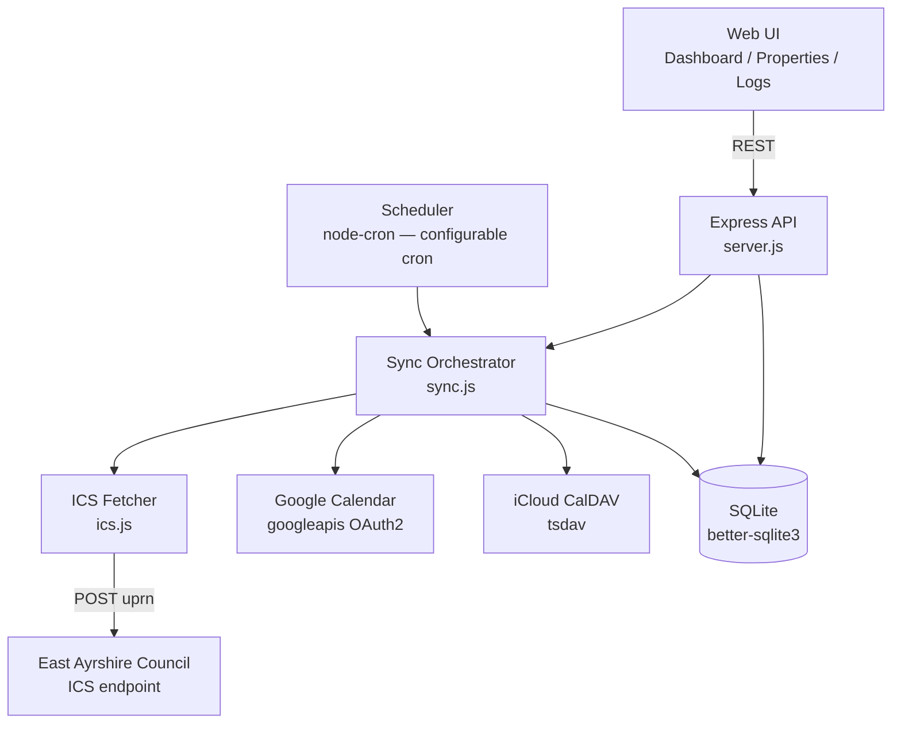

# bin-calendar

A self-hosted Docker application that fetches bin collection schedules from East Ayrshire Council and syncs them to Google Calendar or iCloud. Runs on a Synology NAS. Supports multiple properties, each with its own calendar target.

## Features

- Fetches ICS files from East Ayrshire Council by UPRN
- Syncs to Google Calendar (OAuth2) or iCloud (CalDAV)
- Multiple properties supported — each syncs independently
- Configurable sync schedule via a custom cron expression (default: 1st of each month)
- Manual sync via the web UI
- Sync history and per-property logs
- Credentials encrypted at rest (AES-256-GCM)

## Architecture



## Requirements

- Docker and Docker Compose
- A Google Cloud project with Calendar API enabled (optional — required for Google Calendar sync)
- An iCloud app-specific password (optional — required for iCloud sync)
- A getAddress.io API key (optional — enables address/UPRN lookup)

## Configuration

Copy `.env.example` and fill in the values:

```bash
cp .env.example .env
```

| Variable | Required | Description |
|---|---|---|
| `ENCRYPTION_KEY` | Yes | 64-character hex string. Generate: `openssl rand -hex 32` |
| `GOOGLE_CLIENT_ID` | For Google | OAuth2 client ID from Google Cloud Console |
| `GOOGLE_CLIENT_SECRET` | For Google | OAuth2 client secret |
| `GOOGLE_REDIRECT_URI` | For Google | Must match the URI whitelisted in Google Cloud Console |
| `PORT` | Optional | HTTP port (default: 3000) |

## Deployment (Synology NAS)

1. Generate an encryption key:
   ```bash
   openssl rand -hex 32
   ```

2. Create the data directory:
   ```bash
   mkdir -p /volume1/docker/bin-calendar/data
   ```

3. Pull the image:
   ```bash
   docker pull ghcr.io/alanwaddington/bin-calendar:latest
   ```

4. Create `docker-compose.yml`:
   ```yaml
   services:
     bin-calendar:
       image: ghcr.io/alanwaddington/bin-calendar:latest
       restart: unless-stopped
       ports:
         - "3000:3000"
       volumes:
         - /volume1/docker/bin-calendar/data:/app/data
       environment:
         ENCRYPTION_KEY: <your-64-char-hex-key>
         GOOGLE_CLIENT_ID: <optional>
         GOOGLE_CLIENT_SECRET: <optional>
         GOOGLE_REDIRECT_URI: http://<nas-ip>:3000/auth/google/callback
   ```

5. Start:
   ```bash
   docker compose up -d
   ```

6. Open `http://<nas-ip>:3000`

### Automated deployment (self-hosted runner)

Steps 1–6 above are the one-time initial setup. After that, merges to `main` deploy automatically via a GitHub Actions self-hosted runner installed **on the NAS itself** — no inbound ports opened, no SSH access from GitHub's cloud runners. The runner only makes outbound connections to GitHub (same as checking for software updates).

**One-time setup, on the NAS:**

1. If the GHCR package is private, authenticate Docker on the NAS once (skip if the package is public):
   ```bash
   docker login ghcr.io -u alanwaddington
   # password: a GitHub PAT with read:packages scope
   ```

2. Get a registration command from GitHub: repo → **Settings → Actions → Runners → New self-hosted runner**, choose **Linux**. GitHub shows a `config.sh --url ... --token ...` command with a token valid for ~1 hour — copy it for the next step rather than running it directly (the NAS runs everything in Docker, including this).

3. Run the runner as a container (keeps it isolated from DSM, matches how bin-calendar itself already runs):
   ```bash
   mkdir -p /volume1/docker/gh-runner
   docker run -d --name gh-runner --restart unless-stopped \
     -v /volume1/docker/gh-runner:/home/runner \
     -v /volume1/docker/bin-calendar:/volume1/docker/bin-calendar \
     -v /var/run/docker.sock:/var/run/docker.sock \
     -e REPO_URL=https://github.com/alanwaddington/bin-calendar \
     -e RUNNER_TOKEN=<token-from-step-2> \
     -e RUNNER_NAME=nas \
     myoung34/github-runner:latest
   ```
   The second volume mount makes `/volume1/docker/bin-calendar` (where the NAS's own `docker-compose.yml` lives) visible at the identical path inside the runner container, since the `deploy` job's `cd /volume1/docker/bin-calendar` assumes that path exists on whatever machine the job runs on. The Docker socket mount lets the runner drive the *host's* Docker daemon (so `docker compose up -d` restarts the real `bin-calendar` container, not a nested one inside the runner).

   `myoung34/github-runner` is a commonly used community image for exactly this pattern — review it before trusting it with Docker socket access, or build your own from [GitHub's official runner release](https://github.com/actions/runner/releases) if you'd rather not depend on a third party.

4. Confirm it registered: **Settings → Actions → Runners** should show `nas` as idle.

From here, every merge to `main` runs test → build → deploy automatically, and `docker image prune -f` in the deploy step keeps old image layers from accumulating on the NAS's storage over time.

## Development

### Install dependencies

```bash
npm install
```

### Run locally

```bash
ENCRYPTION_KEY=$(openssl rand -hex 32) node src/server.js
```

### Run tests

```bash
npm test
```

Tests run with coverage. The 80% threshold is enforced — the build fails if coverage drops below this on any metric.

### Test structure

```
tests/
├── helpers/
│   └── testDb.js           # In-memory SQLite factory
├── fixtures/
│   └── ics-samples.js      # ICS text samples for parsing tests
├── unit/
│   ├── crypto.test.js
│   ├── ics.test.js
│   ├── scheduler.test.js
│   └── db.test.js
├── integration/
│   ├── sync.test.js
│   ├── google.test.js
│   └── icloud.test.js
└── api/
    └── server.test.js      # Supertest — all Express routes
```

## CI/CD

GitHub Actions builds and pushes the Docker image to GHCR on every push to `main`, then deploys it to the NAS. Tests must pass before the image is built.

```
push to main
  └─ test job (npm ci && npm test)                [GitHub-hosted runner]
       └─ build job (Docker build & push to ghcr.io)   [GitHub-hosted runner]
            └─ deploy job (docker compose pull && up -d)  [self-hosted runner, on the NAS]
```

Pull requests also run the test job (no Docker build, no deploy).

The `deploy` job runs on a **self-hosted runner installed directly on the NAS** — see "Automated deployment" below for setup. This means deploys happen with no inbound ports opened on the NAS/router: the runner polls GitHub outbound only, same as any other outgoing connection.

## API

| Method | Path | Description |
|---|---|---|
| GET | `/health` | Health check — returns `{ status, nextSync }` |
| GET | `/api/config` | Feature flags (Google configured, address lookup configured) |
| GET | `/api/properties` | List all properties |
| POST | `/api/properties` | Create a property |
| PUT | `/api/properties/:id` | Update label and UPRN |
| DELETE | `/api/properties/:id` | Delete a property |
| GET | `/api/google/auth-url/:propertyId` | Start Google OAuth flow |
| POST | `/api/google/complete` | Complete Google OAuth (paste callback URL) |
| GET | `/api/google/calendars/:propertyId` | List Google calendars for a property |
| PUT | `/api/properties/:id/calendar` | Set the target calendar |
| POST | `/api/icloud/calendars` | Fetch iCloud calendar list |
| POST | `/api/properties/:id/icloud` | Save iCloud credentials |
| POST | `/api/sync` | Trigger a manual sync |
| GET | `/api/sync/runs` | Sync history |
| GET | `/api/next-collection` | Next upcoming bin collection across all properties |
| GET | `/api/bin-types` | List bin type label/colour mappings |
| POST | `/api/bin-types` | Create a bin type mapping |
| PUT | `/api/bin-types/:id` | Update a bin type mapping |
| DELETE | `/api/bin-types/:id` | Delete a bin type mapping |
| GET | `/api/settings/sync-schedule` | Get current sync cron expression and next run date |
| PUT | `/api/settings/sync-schedule` | Update sync cron expression |

## Data

SQLite database stored at `/app/data/bin-calendar.db` (volume-mounted on NAS). Migrations run automatically at startup. Sync logs are retained for 90 days.
