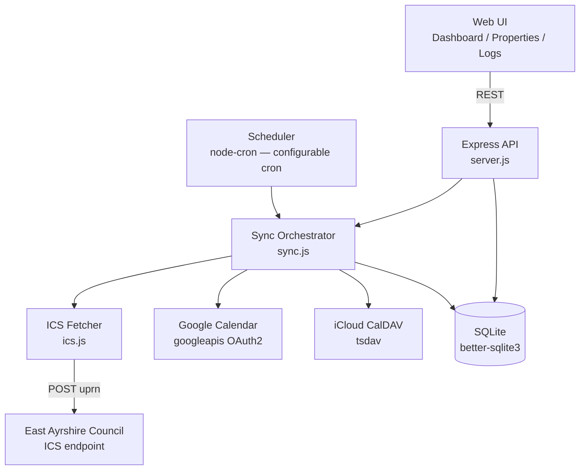

# bin-calendar

A self-hosted Docker application that fetches bin collection schedules from East Ayrshire Council and syncs them to Google Calendar or iCloud. Runs on a Synology NAS. Supports multiple properties, each with its own calendar target.

## Features

- Fetches ICS files from East Ayrshire Council by UPRN
- Syncs to Google Calendar (OAuth2) or iCloud (CalDAV)
- Multiple properties supported — each syncs independently
- Configurable sync schedule via a custom cron expression (default: 1st of each month)
- Manual sync via the web UI
- Per-property calendar view — month grid (desktop) / agenda list (mobile) of synced collection dates, with month navigation and a property switcher
- Sync history and per-property logs
- Credentials encrypted at rest (AES-256-GCM)

## Architecture



## Requirements

- Docker and Docker Compose
- A Google Cloud project with Calendar API enabled (optional — required for Google Calendar sync)
- An iCloud app-specific password (optional — required for iCloud sync)
- A getAddress.io API key (optional — enables address/UPRN lookup)

## Configuration

Copy `.env.example` and fill in the values:

```bash
cp .env.example .env
```

| Variable | Required | Description |
|---|---|---|
| `ENCRYPTION_KEY` | Yes | 64-character hex string. Generate: `openssl rand -hex 32` |
| `GOOGLE_CLIENT_ID` | For Google | OAuth2 client ID from Google Cloud Console |
| `GOOGLE_CLIENT_SECRET` | For Google | OAuth2 client secret |
| `GOOGLE_REDIRECT_URI` | For Google | Must match the URI whitelisted in Google Cloud Console |
| `PORT` | Optional | HTTP port (default: 3000) |

## Deployment (Synology NAS)

1. Generate an encryption key:
   ```bash
   openssl rand -hex 32
   ```

2. Create the data directory:
   ```bash
   mkdir -p /volume1/docker/bin-calendar/data
   ```

3. Pull the image:
   ```bash
   docker pull ghcr.io/alanwaddington/bin-calendar:latest
   ```

4. Create `docker-compose.yml`:
   ```yaml
   services:
     bin-calendar:
       image: ghcr.io/alanwaddington/bin-calendar:latest
       restart: unless-stopped
       ports:
         - "3000:3000"
       volumes:
         - /volume1/docker/bin-calendar/data:/app/data
       environment:
         ENCRYPTION_KEY: <your-64-char-hex-key>
         GOOGLE_CLIENT_ID: <optional>
         GOOGLE_CLIENT_SECRET: <optional>
         GOOGLE_REDIRECT_URI: http://<nas-ip>:3000/auth/google/callback
   ```

5. Start:
   ```bash
   docker compose up -d
   ```

6. Open `http://<nas-ip>:3000`

### Automated deployment (Watchtower)

Steps 1–6 above are the one-time initial setup. After that, **Watchtower** — a small container running on the NAS itself — periodically checks GHCR for a new `bin-calendar:latest` image and auto-restarts the container when one appears. No inbound ports opened, no GitHub Actions job-dispatch required (see below for why that matters here).

> **Note on history:** this project originally tried a GitHub Actions self-hosted runner for this (a `deploy` job dispatched straight from the `build` job). That approach was abandoned — after extensive troubleshooting (confirmed clean runner registration, correct labels, reachable endpoints, no errors anywhere in the runner's own logs) jobs still wouldn't dispatch to it, pointing to a GitHub-platform-side scheduling issue for this specific runner/account that wasn't fixable from the NAS side. Watchtower sidesteps the whole problem since it only needs simple periodic outbound polling, not a sustained job-dispatch connection.

#### A. Get a terminal on the NAS

1. DSM → **Control Panel → Terminal & SNMP → Enable SSH service** (if not already on). Note the port (default `22`).
2. From your Windows machine: `ssh <your-dsm-username>@<nas-ip> -p 22`
3. **On Synology, prefix every `docker`/`docker compose` command below with `sudo`.** DSM's regular SSH users don't have direct access to the Docker socket by default (confirmed: a bare `docker login` fails with `permission denied while trying to connect to the Docker daemon socket`).

#### B. Authenticate Docker on the NAS (skip if the GHCR package is public)

```bash
sudo docker login ghcr.io -u alanwaddington
# password: a GitHub PAT (classic) with read:packages scope — https://github.com/settings/tokens
```

Confirm it worked:
```bash
sudo docker pull ghcr.io/alanwaddington/bin-calendar:latest
```

#### C. Launch Watchtower, scoped to just this one container

```bash
sudo docker run -d --name watchtower --restart unless-stopped \
  -v /var/run/docker.sock:/var/run/docker.sock \
  -v /root/.docker/config.json:/config.json:ro \
  containrrr/watchtower \
  --interval 300 \
  --cleanup \
  bin-calendar
```

What each part is doing:
- The trailing `bin-calendar` argument **restricts Watchtower to that one named container only** — important on a NAS running several other unrelated containers (Home Assistant, Portainer, a travel-wiki stack, etc.) that you don't want silently auto-updated too. Without naming a container, Watchtower watches *everything*.
- `--interval 300` checks every 5 minutes; adjust as you like.
- `--cleanup` removes the old image after a successful update, so layers don't accumulate on NAS storage over time.
- The `config.json` mount reuses the GHCR login from step B (read-only) so Watchtower can pull if the package is private — this is why step B has to happen with `sudo` too (so the credentials land in `/root/.docker/config.json`, the path mounted here).

#### D. Verify it's running

```bash
sudo docker logs watchtower --tail 20
```
You should see it start up and log its first scan. Then confirm it's actually polling on schedule:
```bash
sudo docker logs watchtower --tail 5 --since 10m
```

#### E. Test it end to end

Push any trivial change to `main` (or merge a PR into it) so a new image gets built and published to GHCR. Within one `--interval` period (5 minutes by default), Watchtower should detect the new digest and restart `bin-calendar`:
```bash
sudo docker ps   # bin-calendar's "CREATED"/"STATUS" should show a recent restart
sudo docker logs watchtower --tail 20   # should show it found and applied an update
```

#### Troubleshooting

| Symptom | Likely cause |
|---|---|
| Bare `docker` command fails with `permission denied ... docker daemon socket` | Normal on Synology — prefix the command with `sudo` |
| Watchtower logs `unauthorized` or `401` trying to pull | GHCR login (step B) wasn't done as `sudo`, so the mounted `/root/.docker/config.json` doesn't have the credentials, or the PAT lacks `read:packages`/has expired |
| Watchtower updates *other* containers you didn't expect | The container-name argument was left off `docker run` — it must end with `bin-calendar` to scope it |
| `bin-calendar` doesn't restart after a new image is confirmed in GHCR | Check `sudo docker logs watchtower` for the actual error; confirm the container name really is `bin-calendar` (`sudo docker ps`) |

#### Cleaning up the abandoned self-hosted-runner attempt

If you went through the earlier self-hosted runner setup before this section was rewritten, remove the now-unused pieces:
```bash
sudo docker rm -f gh-runner
rm -rf /volume1/docker/gh-runner
```
The runner's GitHub-side registration has already been removed via the API as part of this troubleshooting session — **Settings → Actions → Runners** should show none listed.

## Development

### Install dependencies

```bash
npm install
```

### Run locally

```bash
ENCRYPTION_KEY=$(openssl rand -hex 32) node src/server.js
```

### Run tests

```bash
npm test
```

Tests run with coverage. The 80% threshold is enforced — the build fails if coverage drops below this on any metric.

### Test structure

```
tests/
├── helpers/
│   ├── testDb.js              # In-memory SQLite factory + real migrations
│   └── browserDom.js          # jsdom window loading the real public/*.js files
├── fixtures/
│   └── ics-samples.js         # ICS text samples for parsing tests
├── unit/
│   ├── crypto.test.js
│   ├── ics.test.js
│   ├── scheduler.test.js
│   ├── db.test.js
│   ├── credential-check.test.js
│   ├── google-credentials.test.js
│   ├── icloud-credentials.test.js
│   ├── sync-cache.test.js
│   ├── calendar-events.test.js    # GET /api/properties/:id/events against a real DB
│   └── calendar-frontend.test.js  # public/calendar.js via browserDom.js
├── integration/
│   ├── sync.test.js
│   ├── google.test.js
│   └── icloud.test.js
└── api/
    └── server.test.js      # Supertest — all Express routes
```

## CI/CD

GitHub Actions builds and pushes the Docker image to GHCR on every push to `main`. Tests must pass before the image is built. Getting that new image running on the NAS is then handled separately, by Watchtower polling GHCR directly — see "Automated deployment (Watchtower)" above.

```
push to main
  └─ test job (npm ci && npm test)                [GitHub-hosted runner]
       └─ build job (Docker build & push to ghcr.io)   [GitHub-hosted runner]

(separately, on the NAS, on its own schedule)
Watchtower polls GHCR every 5 min
  └─ new digest found → docker compose pull && up -d (bin-calendar only)
```

Pull requests also run the test job (no Docker build).

## API

| Method | Path | Description |
|---|---|---|
| GET | `/health` | Health check — returns `{ status, nextSync }` |
| GET | `/api/config` | Feature flags (Google configured, address lookup configured) |
| GET | `/api/properties` | List all properties |
| POST | `/api/properties` | Create a property |
| PUT | `/api/properties/:id` | Update label and ICS calendar URL |
| DELETE | `/api/properties/:id` | Delete a property |
| GET | `/api/properties/:id/events` | Cached collection events for a property (calendar view) |
| GET | `/api/google/auth-url/:propertyId` | Start Google OAuth flow |
| POST | `/api/google/complete` | Complete Google OAuth (paste callback URL) |
| GET | `/api/google/calendars/:propertyId` | List Google calendars for a property |
| PUT | `/api/properties/:id/calendar` | Set the target calendar |
| POST | `/api/icloud/calendars` | Fetch iCloud calendar list |
| POST | `/api/properties/:id/icloud` | Save iCloud credentials |
| POST | `/api/sync` | Trigger a manual sync |
| GET | `/api/sync/runs` | Sync history |
| GET | `/api/next-collection` | Next upcoming bin collection across all properties |
| GET | `/api/bin-types` | List bin type label/colour mappings |
| POST | `/api/bin-types` | Create a bin type mapping |
| PUT | `/api/bin-types/:id` | Update a bin type mapping |
| DELETE | `/api/bin-types/:id` | Delete a bin type mapping |
| GET | `/api/settings/sync-schedule` | Get current sync cron expression and next run date |
| PUT | `/api/settings/sync-schedule` | Update sync cron expression |

## Data

SQLite database stored at `/app/data/bin-calendar.db` (volume-mounted on NAS). Migrations run automatically at startup. Sync logs are retained for 90 days.
