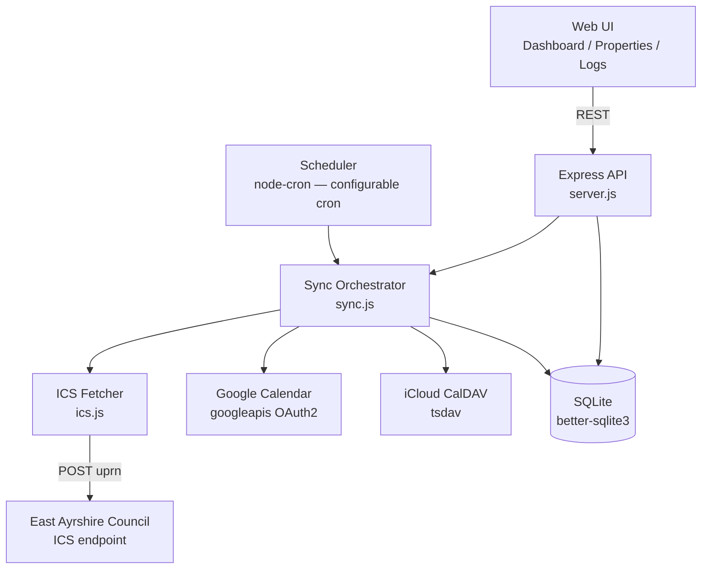

# bin-calendar

A self-hosted Docker application that fetches bin collection schedules from East Ayrshire Council and syncs them to Google Calendar or iCloud. Runs on a Synology NAS. Supports multiple properties, each with its own calendar target.

## Features

- Fetches ICS files from East Ayrshire Council by UPRN
- Syncs to Google Calendar (OAuth2) or iCloud (CalDAV)
- Multiple properties supported — each syncs independently
- Configurable sync schedule via a custom cron expression (default: 1st of each month)
- Manual sync via the web UI
- Sync history and per-property logs
- Credentials encrypted at rest (AES-256-GCM)

## Architecture



## Requirements

- Docker and Docker Compose
- A Google Cloud project with Calendar API enabled (optional — required for Google Calendar sync)
- An iCloud app-specific password (optional — required for iCloud sync)
- A getAddress.io API key (optional — enables address/UPRN lookup)

## Configuration

Copy `.env.example` and fill in the values:

```bash
cp .env.example .env
```

| Variable | Required | Description |
|---|---|---|
| `ENCRYPTION_KEY` | Yes | 64-character hex string. Generate: `openssl rand -hex 32` |
| `GOOGLE_CLIENT_ID` | For Google | OAuth2 client ID from Google Cloud Console |
| `GOOGLE_CLIENT_SECRET` | For Google | OAuth2 client secret |
| `GOOGLE_REDIRECT_URI` | For Google | Must match the URI whitelisted in Google Cloud Console |
| `PORT` | Optional | HTTP port (default: 3000) |

## Deployment (Synology NAS)

1. Generate an encryption key:
   ```bash
   openssl rand -hex 32
   ```

2. Create the data directory:
   ```bash
   mkdir -p /volume1/docker/bin-calendar/data
   ```

3. Pull the image:
   ```bash
   docker pull ghcr.io/alanwaddington/bin-calendar:latest
   ```

4. Create `docker-compose.yml`:
   ```yaml
   services:
     bin-calendar:
       image: ghcr.io/alanwaddington/bin-calendar:latest
       restart: unless-stopped
       ports:
         - "3000:3000"
       volumes:
         - /volume1/docker/bin-calendar/data:/app/data
       environment:
         ENCRYPTION_KEY: <your-64-char-hex-key>
         GOOGLE_CLIENT_ID: <optional>
         GOOGLE_CLIENT_SECRET: <optional>
         GOOGLE_REDIRECT_URI: http://<nas-ip>:3000/auth/google/callback
   ```

5. Start:
   ```bash
   docker compose up -d
   ```

6. Open `http://<nas-ip>:3000`

### Automated deployment (self-hosted runner)

Steps 1–6 above are the one-time initial setup. After that, merges to `main` deploy automatically via a GitHub Actions self-hosted runner installed **on the NAS itself** — no inbound ports opened, no SSH access from GitHub's cloud runners. The runner only makes outbound connections to GitHub (same as checking for software updates).

#### A. Get a terminal on the NAS

1. DSM → **Control Panel → Terminal & SNMP → Enable SSH service** (if not already on). Note the port (default `22`).
2. From your Windows machine: `ssh <your-dsm-username>@<nas-ip> -p 22`
3. Docker commands on DSM sometimes need `sudo` unless your user is in the `docker` group — if you already run `docker compose up -d` for bin-calendar without `sudo`, you're fine; otherwise prefix the `docker` commands below with `sudo`.

#### B. Create one GitHub token for both GHCR pull and runner registration

Rather than two separate tokens, one classic PAT with both scopes covers everything below:

1. On GitHub (in a browser, not the NAS): **https://github.com/settings/tokens → Generate new token (classic)**
2. Name it something like `bin-calendar-nas`, set an expiration you're comfortable with
3. Select scopes: **`repo`** (needed for the runner to register itself) and **`read:packages`** (needed to pull from GHCR if the package is private)
4. Generate, then **copy the token immediately** — GitHub only shows it once. Paste it somewhere temporarily (you'll use it twice, in steps C and D below) and delete that note once both are done.

#### C. Authenticate Docker on the NAS (skip if the GHCR package is public)

```bash
docker login ghcr.io -u alanwaddington
# password: paste the token from step B
```

Confirm it worked:
```bash
docker pull ghcr.io/alanwaddington/bin-calendar:latest
```

#### D. Launch the runner container

```bash
mkdir -p /volume1/docker/gh-runner
docker run -d --name gh-runner --restart unless-stopped \
  -v /volume1/docker/gh-runner:/home/runner \
  -v /volume1/docker/bin-calendar:/volume1/docker/bin-calendar \
  -v /var/run/docker.sock:/var/run/docker.sock \
  -e REPO_URL=https://github.com/alanwaddington/bin-calendar \
  -e ACCESS_TOKEN=<token-from-step-B> \
  -e RUNNER_NAME=nas \
  -e RUNNER_SCOPE=repo \
  -e LABELS=self-hosted,nas \
  myoung34/github-runner:latest
```

What each part is doing:
- `ACCESS_TOKEN` (not `RUNNER_TOKEN`) — the container uses this PAT to generate its own short-lived registration token internally, and does it again automatically if the container ever restarts. You never have to manually copy a 1-hour expiring token from GitHub's UI.
- The second `-v` mount makes `/volume1/docker/bin-calendar` (where the NAS's own `docker-compose.yml` lives, from step 4 earlier) visible **at the identical path** inside the runner container — the `deploy` job's `cd /volume1/docker/bin-calendar` assumes that path exists wherever the job runs, so the path has to match on both sides of the mount.
- The `docker.sock` mount lets the runner drive the **host's** Docker daemon directly, so `docker compose up -d` restarts the real `bin-calendar` container running on the NAS — not a nested container isolated inside the runner that would have no effect on anything.
- `myoung34/github-runner` is a commonly used community image for exactly this pattern — review it yourself before trusting it with Docker socket access (that access is effectively root on the host), or build your own from [GitHub's official runner release](https://github.com/actions/runner/releases) if you'd rather not depend on a third party.

#### E. Verify it registered

```bash
docker logs gh-runner
```
Look for a line like `Listening for Jobs`. Then on GitHub: repo → **Settings → Actions → Runners** should show `nas` with a green **Idle** status. If it's missing:
- `docker logs gh-runner` will usually show why (bad token, network issue, etc.)
- Re-check the PAT has the `repo` scope and hasn't expired
- `docker ps` to confirm the container is actually running, not restart-looping (`docker ps -a` if it's not in the list at all)

#### F. Test the whole pipeline end to end

Push any trivial change to `main` (or merge a PR into it) and watch: repo → **Actions** tab → the workflow run should show `test` → `build` → `deploy` all green, with `deploy` showing `nas` as the runner it executed on. Then confirm on the NAS itself:
```bash
docker ps   # bin-calendar's "CREATED" time should be recent
docker compose -f /volume1/docker/bin-calendar/docker-compose.yml logs --tail 20 bin-calendar
```

#### Troubleshooting

| Symptom | Likely cause |
|---|---|
| `deploy` job stays queued forever in the Actions tab | Runner isn't registered, or is offline — check `docker ps` and `docker logs gh-runner` on the NAS |
| Runner shows **Offline** on GitHub | Container isn't running (`docker ps -a`) or lost network — `docker start gh-runner` |
| `deploy` step fails on `docker compose pull` with `unauthorized` | GHCR login (step C) wasn't done, or the PAT lacks `read:packages` and/or has expired |
| `deploy` step fails with `no such file or directory` on the `cd` | The two paths in the `-v` mount (step D) don't match — both sides must be `/volume1/docker/bin-calendar` |
| Runner re-registers as a *new* runner every restart instead of reconnecting | Using `RUNNER_TOKEN` instead of `ACCESS_TOKEN` — switch to `ACCESS_TOKEN` as shown above |

From here, every merge to `main` runs test → build → deploy automatically, and `docker image prune -f` in the deploy step keeps old image layers from accumulating on the NAS's storage over time.

## Development

### Install dependencies

```bash
npm install
```

### Run locally

```bash
ENCRYPTION_KEY=$(openssl rand -hex 32) node src/server.js
```

### Run tests

```bash
npm test
```

Tests run with coverage. The 80% threshold is enforced — the build fails if coverage drops below this on any metric.

### Test structure

```
tests/
├── helpers/
│   └── testDb.js           # In-memory SQLite factory
├── fixtures/
│   └── ics-samples.js      # ICS text samples for parsing tests
├── unit/
│   ├── crypto.test.js
│   ├── ics.test.js
│   ├── scheduler.test.js
│   └── db.test.js
├── integration/
│   ├── sync.test.js
│   ├── google.test.js
│   └── icloud.test.js
└── api/
    └── server.test.js      # Supertest — all Express routes
```

## CI/CD

GitHub Actions builds and pushes the Docker image to GHCR on every push to `main`, then deploys it to the NAS. Tests must pass before the image is built.

```
push to main
  └─ test job (npm ci && npm test)                [GitHub-hosted runner]
       └─ build job (Docker build & push to ghcr.io)   [GitHub-hosted runner]
            └─ deploy job (docker compose pull && up -d)  [self-hosted runner, on the NAS]
```

Pull requests also run the test job (no Docker build, no deploy).

The `deploy` job runs on a **self-hosted runner installed directly on the NAS** — see "Automated deployment" below for setup. This means deploys happen with no inbound ports opened on the NAS/router: the runner polls GitHub outbound only, same as any other outgoing connection.

## API

| Method | Path | Description |
|---|---|---|
| GET | `/health` | Health check — returns `{ status, nextSync }` |
| GET | `/api/config` | Feature flags (Google configured, address lookup configured) |
| GET | `/api/properties` | List all properties |
| POST | `/api/properties` | Create a property |
| PUT | `/api/properties/:id` | Update label and UPRN |
| DELETE | `/api/properties/:id` | Delete a property |
| GET | `/api/google/auth-url/:propertyId` | Start Google OAuth flow |
| POST | `/api/google/complete` | Complete Google OAuth (paste callback URL) |
| GET | `/api/google/calendars/:propertyId` | List Google calendars for a property |
| PUT | `/api/properties/:id/calendar` | Set the target calendar |
| POST | `/api/icloud/calendars` | Fetch iCloud calendar list |
| POST | `/api/properties/:id/icloud` | Save iCloud credentials |
| POST | `/api/sync` | Trigger a manual sync |
| GET | `/api/sync/runs` | Sync history |
| GET | `/api/next-collection` | Next upcoming bin collection across all properties |
| GET | `/api/bin-types` | List bin type label/colour mappings |
| POST | `/api/bin-types` | Create a bin type mapping |
| PUT | `/api/bin-types/:id` | Update a bin type mapping |
| DELETE | `/api/bin-types/:id` | Delete a bin type mapping |
| GET | `/api/settings/sync-schedule` | Get current sync cron expression and next run date |
| PUT | `/api/settings/sync-schedule` | Update sync cron expression |

## Data

SQLite database stored at `/app/data/bin-calendar.db` (volume-mounted on NAS). Migrations run automatically at startup. Sync logs are retained for 90 days.
